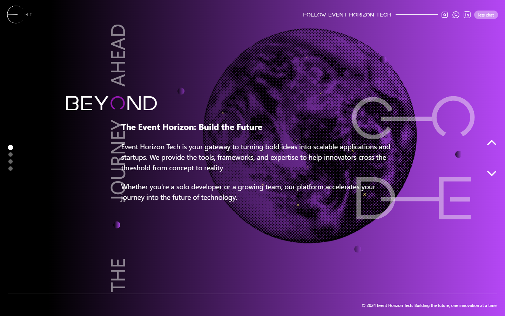

# Quantum

An unfinished Next.js animation prototype for an Event Horizon Tech landing page. Four full-screen sections combine GSAP transitions, gradients, an orbiting Earth and project imagery. Repository history records Ramtin's implementation work; the agency copy is prototype content, not evidence of shipped client projects.



## Run locally

Use Node.js and npm; verification used Node 24.11.1 on Windows. The repository does not declare a Node engine.

```bash
git clone https://github.com/boyInShadows/Quantum.git
cd Quantum
npm ci
npm run dev
```

Open http://localhost:3000. For a production preview, run `npm run build` then `npm start`. `npm run lint` runs the existing Next.js lint configuration. No environment variables or API service are required for the current page; the declared OpenAI dependency has no active integration in the reviewed application source.

## Interaction and implementation

- Scroll, press Arrow Up/Down or Page Up/Down, or use the two arrow buttons to cycle through sections. Transitions temporarily lock navigation while the GSAP overlay and content animations complete.
- [MainPage](app/components/mainPage/index.js) keeps section state and animation references; [EarthWithStars](app/components/mainPage/EarthWithStars.js) supplies the rotating illustration and CSS sparkles.
- [quantumSector](https://github.com/boyInShadows/quantumSector) is a separate experiments repository. Its trading/reminder UI is not a feature of this page. The Event Horizon-branded repositories retain their own histories and scope.

## Verification and limits

Locked installation, lint and production build passed locally. Lint reports four existing effect/callback dependency warnings. Edge checks verified forward/back keyboard navigation and actual desktop/mobile rendering; the capture above is the running production build. Asset paths were corrected to match Git's exact `public/Images` spelling, with an assert check that failed before the fix and passed afterward. A Linux build was not run.

This is not a released agency service. “Let's chat,” project and “learn more” actions are unfinished; social links point to generic platforms. The first section uses styled text instead of semantic headings, arrow controls lack accessible names, and mobile content overlaps/clips despite matching viewport width. Touch navigation, reduced motion, full accessibility and physical-device smoothness remain unverified. No automated test suite or quality CI is configured.

The reviewed production dependency audit reports five findings, including one critical finding. Dependency upgrades and deployment hardening remain separate work; do not treat a successful local build as deployment readiness.
